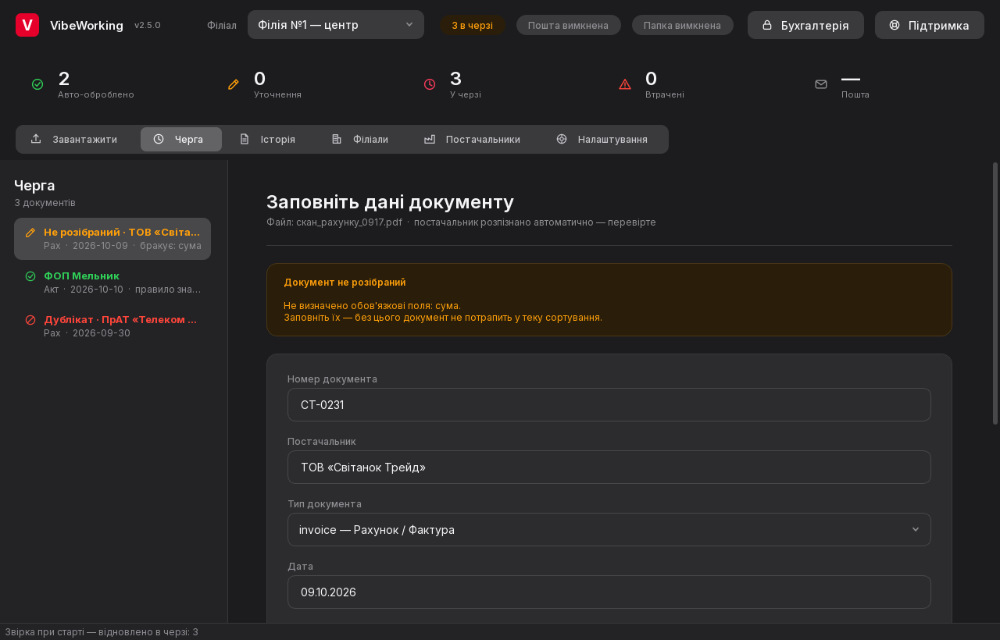
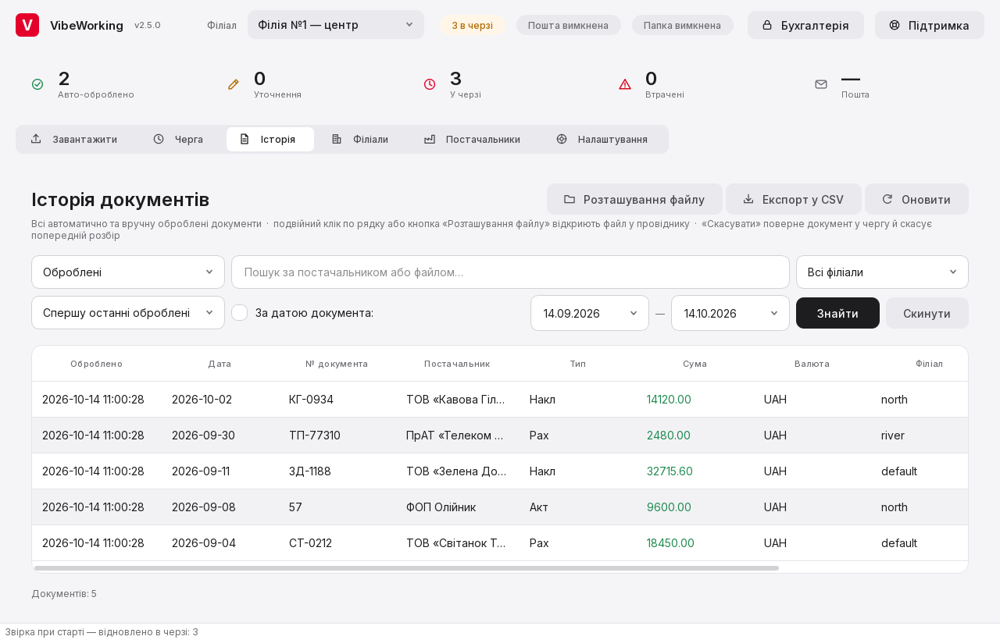
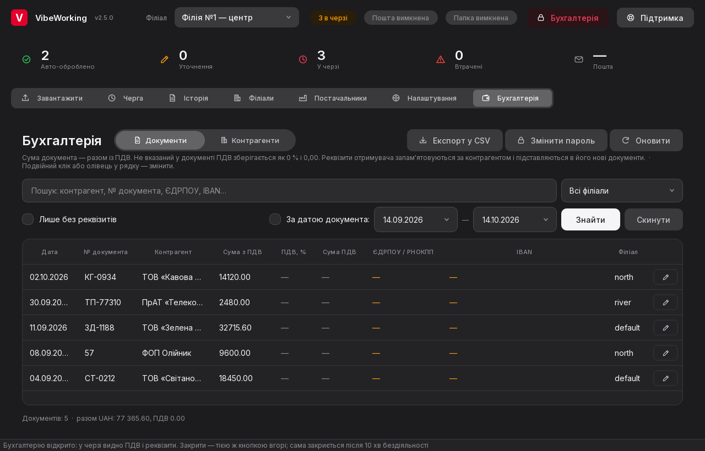
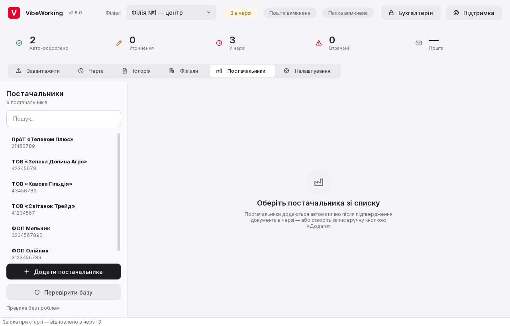

<h2>Mykyta Paliienko</h2>

<b>Junior ML Engineer</b> · 2nd-year Computer Science student, University of Winchester 
I build ML systems end to end — data, a baseline, a model, a held-out evaluation and a feedback loop — and ship them
as real software: a voice assistant with its own wake-word model, a from-scratch language model for causal
inference, an OCR app in production. Before ML: three years of Unity games and Telegram bots.

### Projects

**[AI For Me](https://github.com/KernerlRace/Ai-For-Me)** &nbsp;`in progress · flagship` 
A personal AI layer for my Windows machine, built as small ML systems on a shared event bus. A 60k-parameter
wake-word CNN trained from scratch on my recordings, with hard-negative mining and synthetic whispers (92% on a
separate test session, 0 false accepts in 22 min of held-out audio); Whisper on the GPU; a multilingual intent
classifier (92.4% held out, 90.0% through speech vs 85.9% for TF-IDF); an active-learning loop that ranks commands
by uncertainty for labelling and retrains behind a gate; a mode autopilot; a vision agent grounding commands on
screenshots, with a dataset labelled for free by UI Automation. 
Python · PyTorch · ONNX Runtime · faster-whisper · sentence-transformers · scikit-learn · FastAPI · React · TypeScript · SQLite · GitHub Actions

**VibeWorking** &nbsp;`client project · sole developer · private repo` 
A desktop app that reads and files accounting documents — invoices, acts, waybills — for a multi-branch business.
OCR on ONNX Runtime with a Cyrillic model, field extraction (parties, dates, totals, VAT, IBAN and tax-ID checksums),
supplier rules learned from accountants' corrections, and duplicate detection. Documents arrive through
a PyQt6 desktop UI or a Telegram bot. Ships as a Windows installer with signed (ed25519) auto-updates,
stable/beta channels and rollback. ~32k lines of Python, 50 test suites, CI on GitHub Actions, now at v2.5. 
Python · PyQt6 · RapidOCR · ONNX Runtime · SQLite · python-telegram-bot · PyInstaller · GitHub Actions

More screenshots

Screenshots use fictional demo data.

**[Causal Method Advisor](https://github.com/KernerlRace/causal-method-advisor)** &nbsp;`ML from scratch` &nbsp;[▶ live demo](https://causal-method-advisor.streamlit.app) 
Give it a CSV and a plain-English question — *"Did the campaign raise sales?"* — and it profiles the data,
runs statistical diagnostics and recommends a causal inference method (DiD, synthetic control, IV, RDD, …)
with an explanation. CausalGPT-mini — my own BPE tokenizer and a 34M-parameter GPT-style decoder, pretrained on
Wikipedia and fine-tuned on the task — reads the question and explains the choice while code does the statistics.
On 93 hand-written questions it picks the right method end to end 68% of the time against 58% for a classical-ML
baseline, with calibrated confidence (ECE 0.326 → 0.018) and honest refusals when the data cannot answer.
22 method cards, 18 scenario generators with known ground truth. Next: questions written by other people. 
Python · PyTorch · scikit-learn · statsmodels · pandas · Streamlit

**[Python Mastery RPG](https://github.com/KernerlRace/python-mastery-rpg)** &nbsp;`hackathon · 48 h` &nbsp;[▶ live demo](https://python-mastery-rpg.streamlit.app) 
A gamified platform for learning Python, built at a University of Winchester hackathon:
an in-browser code editor with auto-checked quests, XP and ranks, a leaderboard,
a skills analytics dashboard and an LLM-powered mentor chatbot. 
Python · Streamlit · SQLite · Plotly · OpenAI API

### Stack

### Education

**University of Winchester** — BSc Computer Science, 2nd year 
Relevant coursework: Machine Learning · Artificial Intelligence · Computer Architectures

### Courses

- [x] [CS50x](https://cs50.harvard.edu/x/) — Introduction to Computer Science, Harvard
- [x] [CS50P](https://cs50.harvard.edu/python/) — Introduction to Programming with Python, Harvard
- [x] [CS50AI](https://cs50.harvard.edu/ai/) — Introduction to Artificial Intelligence with Python, Harvard
- [x] [Python Essentials 1 & 2](https://www.netacad.com/) — Cisco Networking Academy
- [x] [Introduction to Data Science](https://www.netacad.com/) — Cisco Networking Academy
- [x] [Neural Networks: Zero to Hero](https://karpathy.ai/zero-to-hero.html) — Andrej Karpathy
- [x] [Hugging Face LLM Course](https://huggingface.co/learn/llm-course) — Hugging Face

### Next: LLM engineering, 2026–27

Weekly notes in [learning-log](https://github.com/KernerlRace/learning-log).

- [ ] [CS336: Language Modeling from Scratch](https://cs336.stanford.edu/) — Stanford
- [ ] [Generative AI with Large Language Models](https://www.coursera.org/learn/generative-ai-with-llms) — DeepLearning.AI & AWS
- [ ] [Finetuning Large Language Models](https://www.deeplearning.ai/short-courses/finetuning-large-language-models/) — DeepLearning.AI
- [ ] [Building and Evaluating Advanced RAG](https://www.deeplearning.ai/short-courses/building-evaluating-advanced-rag/) — DeepLearning.AI
- [ ] [LLM Zoomcamp](https://github.com/DataTalksClub/llm-zoomcamp) — DataTalks.Club
- [ ] [AI Agents Course](https://huggingface.co/learn/agents-course) — Hugging Face
- [ ] [Anthropic courses](https://github.com/anthropics/courses) — prompt engineering and tool use, Anthropic
