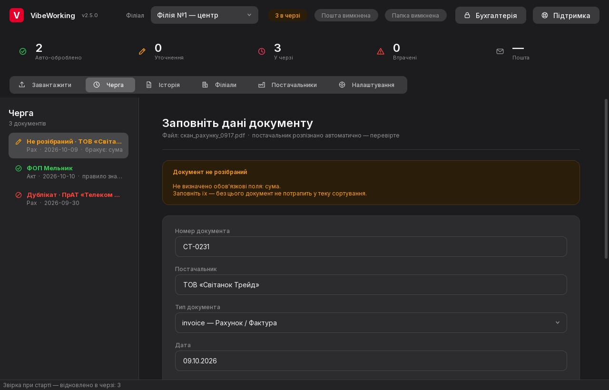
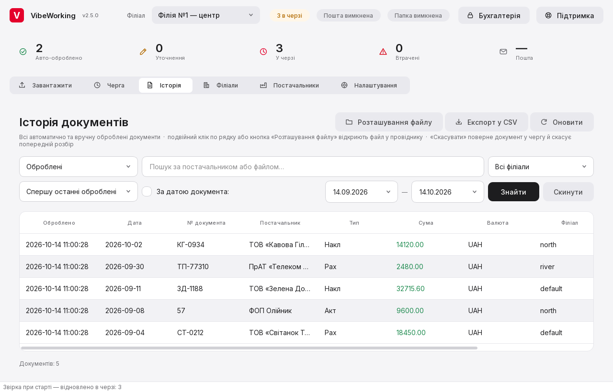
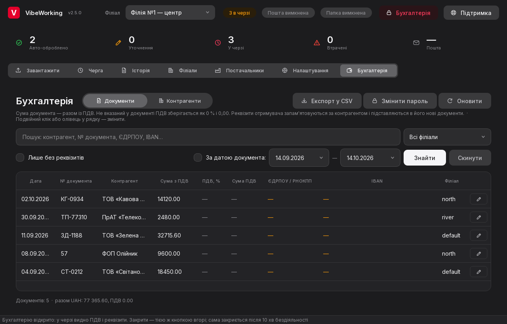
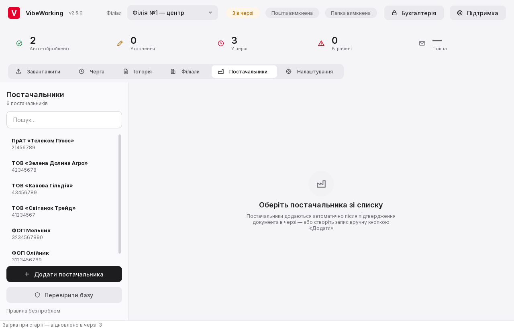

<h2>Mykyta Paliienko</h2>

<b>Junior ML Engineer</b> · 2nd-year Computer Science student 
I like building ML systems end to end — from OCR pipelines and synthetic data to models trained
from scratch — and shipping them as software real people use every day.

### Projects

**VibeWorking** &nbsp;`commercial · sole developer · private repo` 
A desktop app that reads and files accounting documents — invoices, acts, waybills — for a multi-branch business.
OCR on ONNX Runtime with a Cyrillic model, field extraction (parties, dates, totals, VAT, IBAN and tax-ID checksums),
supplier rules learned from accountants' corrections, and duplicate detection. Documents arrive through
a PyQt6 desktop UI or a Telegram bot. Ships as a Windows installer with signed (ed25519) auto-updates,
stable/beta channels and rollback. ~32k lines of Python, 50 test suites, CI on GitHub Actions, now at v2.5. 
Python · PyQt6 · RapidOCR · ONNX Runtime · SQLite · python-telegram-bot · PyInstaller · GitHub Actions

More screenshots

Screenshots use fictional demo data.

**[Causal Method Advisor](https://github.com/KernerlRace/causal-method-advisor)** &nbsp;`in progress` 
Give it a CSV and a plain-English question — *"Did the campaign raise sales?"* — and it profiles the data,
runs statistical diagnostics and recommends a causal inference method (DiD, synthetic control, IV, RDD, …)
with an explanation. 22 method cards, 17 synthetic scenario generators with known ground truth,
a classical-ML baseline at 83.6% end-to-end top-1. Next: a small transformer trained from scratch. 
Python · PyTorch · scikit-learn · statsmodels · pandas · Streamlit

**[Python Mastery RPG](https://github.com/KernerlRace/python-mastery-rpg)** &nbsp;`hackathon · 48 h` 
A gamified platform for learning Python, built at a University of Winchester hackathon:
an in-browser code editor with auto-checked quests, XP and ranks, a leaderboard,
a skills analytics dashboard and an LLM-powered mentor chatbot. 
Python · Streamlit · SQLite · Plotly · OpenAI API

### Stack

### Education

**University of Winchester** — BSc Computer Science, 2nd year 
Relevant coursework: Machine Learning · Artificial Intelligence · Computer Architectures

### Learning path 2026–27

- [ ] [CS50x](https://cs50.harvard.edu/x/) — Introduction to Computer Science, Harvard
- [ ] [CS50P](https://cs50.harvard.edu/python/) — Introduction to Programming with Python, Harvard
- [ ] [CS50AI](https://cs50.harvard.edu/ai/) — Introduction to Artificial Intelligence with Python, Harvard
- [ ] [Python Essentials 1 & 2](https://www.netacad.com/) — Cisco Networking Academy
- [ ] [Introduction to Data Science](https://www.netacad.com/) — Cisco Networking Academy
- [ ] [Neural Networks: Zero to Hero](https://karpathy.ai/zero-to-hero.html) — Andrej Karpathy
- [ ] [Hugging Face LLM Course](https://huggingface.co/learn/llm-course) — Hugging Face
